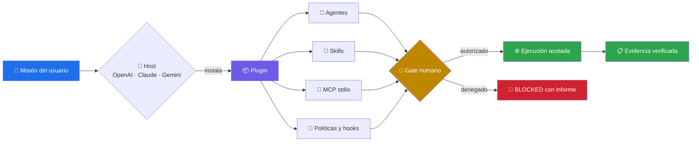
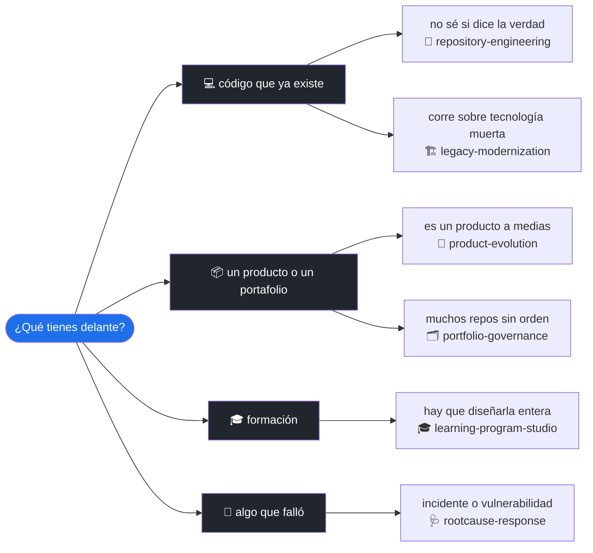
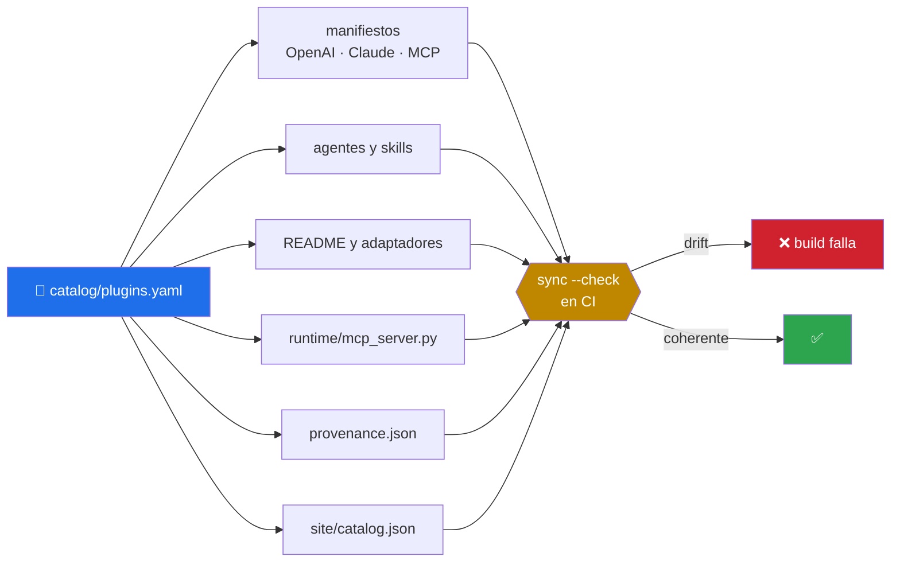

<div align="center">

# 🧩 agentic-plugins-toolkit

### 📦 Plugins agénticos componibles, evaluables y distribuibles para [Claude Code](https://claude.com/claude-code), OpenAI/Codex, Copilot, Gemini y cualquier host [MCP](https://modelcontextprotocol.io/)

Un **plugin** empaqueta agentes, skills, un servidor MCP, hooks, políticas, evaluaciones y adaptadores alrededor de **una misión** — 🧭 ingeniería de repositorios, 🏗️ modernización de legacy, 🎓 programas formativos, 🚀 evolución de producto, 🗂️ gobernanza de portafolio y 🩺 respuesta a incidentes.
**Cero dependencias de runtime** — la CLI usa solo la biblioteca estándar de Python.

[](LICENSE)
[](CHANGELOG.md)
[](pyproject.toml)
[](#-catálogo)
[](catalog/agents.snapshot.json)
[](#-instalación)
[](https://github.com/vladimiracunadev-create/agentic-plugins-toolkit/actions/workflows/ci.yml)
[](https://github.com/vladimiracunadev-create/agentic-plugins-toolkit/actions/workflows/codeql.yml)
[](tests/test_toolkit.py)
[](docs/EVALUATION.md)
[](docs/MATURITY_MODEL.md)
[](SECURITY.md)
[](CONTRIBUTING.md)
[](https://github.com/vladimiracunadev-create)

[**🌐 Sitio del proyecto**](https://vladimiracunadev-create.github.io/agentic-plugins-toolkit/) · [**📦 Instalación**](#-instalación) · [**📚 Catálogo**](#-catálogo) · [**🚀 Uso**](#-uso) · [**🧭 Diseño**](#-diseño) · [**🔒 Seguridad**](#-seguridad) · [**📖 Documentación**](#-documentación) · [**🤝 Contribuir**](CONTRIBUTING.md)

</div>

---

## 💡 ¿Qué es un "plugin" aquí?

Un **plugin** es la unidad de **composición, instalación y distribución**. No es un agente más listo: es el paquete que reúne todo lo que una misión necesita y lo entrega instalable en cinco plataformas distintas.

```text
plugins/<id>/
├── plugin.yaml                    # Contrato canónico del plugin           (generado)
├── .codex-plugin/plugin.json      # Manifiesto OpenAI/Codex                (generado)
├── .claude-plugin/plugin.json     # Manifiesto Claude Code                 (generado)
├── .mcp.json                      # Servidor de control por stdio          (generado)
├── agents/                        # Instantánea versionada de los agentes  (generado)
├── skills/<id>-workflow/SKILL.md  # El workflow de la misión               (generado)
├── hooks/hooks.json               # SessionStart: anuncia los límites      (generado)
├── policies/policy.json           # Permitido · aprobación · denegado      (generado)
├── runtime/mcp_server.py          # Servidor MCP autocontenido             (generado)
├── adapters/                      # Copilot, Gemini, OpenAI, Claude Code   (generado)
├── assets/icon.svg                # Icono del paquete                      (generado)
├── provenance.json                # De dónde viene cada pieza              (generado)
└── evals/cases.jsonl              # Casos deterministas de routing         ← lo único a mano
```

Trece de los catorce elementos se **generan** desde `catalog/plugins.yaml`. El único archivo que se escribe a mano dentro de un paquete es el de evaluaciones, y el validador rechaza cualquier archivo nuevo que no esté en una de esas dos categorías.



> [!IMPORTANT]
> **Skill ≠ agente ≠ plugin.** Un **skill** es una capacidad que el modelo carga en su propio contexto. Un **agente** es una instancia separada a la que se delega una misión completa. Un **plugin** es el **paquete** que compone unos y otros, declara sus límites y los deja instalables. Este repositorio colecciona **plugins**; los agentes viven en [`operational-ai-agents`](https://github.com/vladimiracunadev-create/operational-ai-agents) y los skills en [`claude-skills-toolkit`](https://github.com/vladimiracunadev-create/claude-skills-toolkit).

### El lugar de este repositorio en el ecosistema

| Repositorio | Unidad | Responsabilidad |
|---|---|---|
| [artificial-intelligence-evolution-program](https://github.com/vladimiracunadev-create/artificial-intelligence-evolution-program) | clase / lab | aprender IA y sistemas agénticos |
| [claude-skills-toolkit](https://github.com/vladimiracunadev-create/claude-skills-toolkit) | skill | capacidades reutilizables |
| [operational-ai-agents](https://github.com/vladimiracunadev-create/operational-ai-agents) | agente | trabajadores digitales con misión completa |
| **agentic-plugins-toolkit** | **plugin** | **composición, instalación y distribución** |
| [langgraph-realworld](https://github.com/vladimiracunadev-create/langgraph-realworld) | sistema | procesos reales y equipos multiagente |

---

## 📚 Catálogo

**6 plugins** que componen **10 agentes** distintos. La fuente canónica es **[`catalog/plugins.yaml`](catalog/plugins.yaml)**: manifiestos, fichas, adaptadores, servidores MCP y la landing page se generan desde ahí, y CI rechaza cualquier divergencia.

### ¿Cuál necesito?



| Plugin | Agentes | Riesgo | Misión | Ficha |
|---|---:|:-:|---|---|
| 🧭 **repository-engineering** | 4 | `high` | Convertir mantenimiento amplio en cambios verificables sin confundir documentación, implementación y adopción. | [ver](plugins/repository-engineering/README.md) |
| 🏗️ **legacy-modernization** | 1 | `high` | Reducir deuda y riesgo mediante rebanadas reversibles, pruebas de caracterización y gates de migración. | [ver](plugins/legacy-modernization/README.md) |
| 🎓 **learning-program-studio** | 1 | `medium` | Transformar un dominio en una experiencia formativa profunda, ejecutable, trazable y mantenible. | [ver](plugins/learning-program-studio/README.md) |
| 🚀 **product-evolution** | 1 | `medium` | Alinear intención, experiencia, arquitectura y evidencia para entregar el siguiente incremento útil. | [ver](plugins/product-evolution/README.md) |
| 🗂️ **portfolio-governance** | 1 | `low` | Mantener un catálogo honesto separando aprendizaje, skills, agentes, plugins, casos y productos. | [ver](plugins/portfolio-governance/README.md) |
| 🩺 **rootcause-response** | 2 | `high` | Reducir incertidumbre, preservar evidencia y remediar sin introducir un segundo incidente. | [ver](plugins/rootcause-response/README.md) |

<details>
<summary><b>Qué le pides a cada uno — ejemplos literales</b></summary>

<br>

**🧭 repository-engineering** · `repository-evolution-agent` · `documentation-coherence-agent` · `release-governance-agent` · `repository-maintenance-coordinator`

> «Examina este repositorio y separa lo implementado de lo prometido.»
> «Prepara una evolución verificable y detente antes de publicar.»

**🏗️ legacy-modernization** · `legacy-modernization-agent`

> «Diseña la migración incremental de PHP 5.4 a PHP 8.3.»
> «Crea una estrategia Strangler con pruebas y rollback.»

**🎓 learning-program-studio** · `learning-program-architect`

> «Crea un programa desde nivel novato hasta experto con laboratorios.»
> «Audita la progresión y completa las evaluaciones faltantes.»

**🚀 product-evolution** · `product-evolution-agent`

> «Diferencia stubs, partes funcionales y roadmap de este producto.»
> «Construye el siguiente incremento sin romper formatos anteriores.»

**🗂️ portfolio-governance** · `portfolio-curator-agent`

> «Clasifica mi portafolio y sustenta cada categoría.»
> «Prepara una narrativa para reclutadores sin exagerar madurez.»

**🩺 rootcause-response** · `incident-root-cause-agent` · `security-remediation-agent`

> «Construye la línea temporal y prueba hipótesis para este incidente.»
> «Prioriza remediaciones sin ejecutar cambios productivos.»

</details>

> [!TIP]
> Antes de instalar nada, `agentic-plugins policy-check <plugin> --action "<lo que quieres hacer>"` te dice si esa acción está permitida, exige aprobación humana o está denegada siempre.

---

## 📦 Instalación

### Requisitos

| Requisito | Para qué | ¿Obligatorio? |
|---|---|:-:|
| Python 3.11+ | CLI, validación, evaluaciones, MCP y panel | ✅ |
| Git | clonar y actualizar | ✅ |
| Un host agéntico | ejecutar los plugins de verdad | ❌ solo para ejecución real |
| Docker | levantar el panel en contenedor | ❌ opcional |

No hay dependencias de runtime: la CLI usa únicamente la biblioteca estándar.

### CLI local

```bash
git clone https://github.com/vladimiracunadev-create/agentic-plugins-toolkit.git
cd agentic-plugins-toolkit
python -m pip install -e .
agentic-plugins doctor
```

Si `agentic-plugins` no aparece en el PATH, el equivalente siempre funciona:

```bash
python -m agentic_plugins list
```

### Instalar un plugin en un host

```bash
agentic-plugins export repository-engineering --target ~/.claude/plugins
```

> [!IMPORTANT]
> El exportador **nunca sobrescribe un directorio que no administra**. Si ya tienes un plugin con el mismo nombre sin la marca `.agentic-plugins-managed.json`, la operación falla y tus archivos quedan intactos.

Detalle por plataforma, actualización, desinstalación y problemas frecuentes en **[INSTALL.md](INSTALL.md)**.

---

## 🚀 Uso

### 1 · Explorar sin gastar un solo token

```bash
agentic-plugins list                                 # el catálogo
agentic-plugins inspect rootcause-response           # misión, agentes y límites
agentic-plugins policy-check rootcause-response --action "desplegar a producción"
agentic-plugins eval --all                           # 24 evaluaciones deterministas
```

### 2 · Verificar la integridad del repositorio

```bash
agentic-plugins sync --check     # ninguna vista generada difiere del catálogo
agentic-plugins validate         # contratos, higiene y ausencia de duplicación
```

### 3 · Servidor MCP

```bash
agentic-plugins mcp --plugin repository-engineering
```

O sin instalar nada, directamente el servidor que viaja dentro del paquete:

```bash
python plugins/repository-engineering/runtime/mcp_server.py
```

Ambos responden **exactamente lo mismo**: el segundo se genera copiando el código fuente del primero, y una prueba compara sus respuestas caso por caso.

### 4 · Empaquetar y distribuir

```bash
agentic-plugins package --all --output dist
cat dist/checksums.json
```

Los ZIP son **reproducibles**: mismo contenido, mismo SHA-256, en cualquier máquina y en cualquier momento. CI lo comprueba construyendo dos veces y comparando.

### 5 · Panel local

```bash
agentic-plugins serve --host 127.0.0.1 --port 8787
```

O en contenedor:

```bash
docker compose up --build
```

> [!CAUTION]
> El panel **no implementa autenticación**. Escucha en loopback y salir de ahí exige declarar `AGENTIC_PLUGINS_ALLOW_REMOTE_BIND=1`. No lo expongas a Internet.

### 🛠 Los doce comandos

| Comando | Qué hace |
|---|---|
| `list` | lista el catálogo, con `--json` para consumirlo |
| `inspect <id>` | misión, agentes, gates y acciones denegadas |
| `validate` | contratos, higiene y ausencia de duplicación no gobernada |
| `sync [--check]` | regenera las vistas derivadas, o falla si hay drift |
| `eval <id> \| --all` | evaluaciones deterministas de routing y aprobación |
| `package <id> \| --all` | ZIP reproducibles con `checksums.json` |
| `export <id> --target` | instala preservando lo que no administra |
| `uninstall <id> --target` | elimina **solo** lo que lleva la marca |
| `policy-check <id> --action` | clasifica una acción: permitida, aprobación o denegada |
| `mcp --plugin <id>` | servidor MCP por stdio |
| `serve` | panel local en loopback |
| `doctor` | diagnóstico del entorno y del catálogo |

Referencia completa con flags y códigos de retorno en **[docs/CLI.md](docs/CLI.md)**.

---

## 🧭 Diseño

### 🎯 Principios

- **Vendor-neutral en el núcleo** — catálogo, políticas, evaluaciones y empaquetado no dependen de un proveedor.
- **Los manifiestos son adaptadores** — no se presenta un «formato universal de plugin» que no existe.
- **Todo dato duplicado se genera** — si aparece en dos sitios, uno de los dos es una vista.
- **Read-only primero** — la política por defecto es `allow-read-plan`.
- **Acceso ≠ autorización** — poder leer no es poder publicar.
- **Aprobación real** — ni un agente ni una tool aprueban en tu lugar.
- **Honestidad de estado** — `IMPLEMENTED` significa contrato validado, no producción.
- **Cero dependencias runtime** — solo la biblioteca estándar de Python.

### 🧬 Una sola fuente de verdad

`catalog/plugins.yaml` manda. De él se generan **69 archivos**; editarlos a mano hace fallar la build:



Esto convierte «la documentación está actualizada» —una promesa— en una propiedad que el sistema garantiza.

> [!NOTE]
> El caso que motivó el diseño: `runtime/mcp_server.py` se mantenía a mano y **reimplementaba** la comparación de políticas con `x in action.lower()`. Para la acción `BYPASS_APPROVAL` la CLI respondía `denied` y el servidor que se distribuía dentro del paquete respondía `allowed`. Hoy ese archivo se genera copiando el código fuente literal de `policy.py`, y una prueba compara ambos servidores caso por caso.

### 📁 Estructura

```text
agentic-plugins-toolkit/
├── catalog/                 # fuente única de verdad + instantánea de agentes
├── plugins/                 # un paquete autocontenido por plugin (generado)
├── src/agentic_plugins/     # CLI, validación, renderers, MCP, packager y servidor
├── schemas/                 # JSON Schema del contrato de plugin
├── site/                    # landing page; catalog.json es una vista generada
├── scripts/                 # instalación y verificación local
├── evidence/                # ejecuciones sanitizadas para promover madurez
└── tests/                   # 55 pruebas deterministas sin API
```

Detalle en **[docs/ARCHITECTURE.md](docs/ARCHITECTURE.md)** y **[docs/PLUGIN_CONTRACT.md](docs/PLUGIN_CONTRACT.md)**.

---

## 🔒 Seguridad

Cada garantía está cubierta por una prueba que corre en cada push:

| Control | Garantía | Prueba |
|---|---|---|
| Semántica de política | el servidor distribuido no puede clasificar distinto que la CLI | `test_distributed_server_agrees_with_the_cli` |
| Normalización | `BYPASS_APPROVAL`, `bypass approval` y `Bypass-Approval` son la misma acción denegada | `test_denial_survives_case_and_separator_changes` |
| Gates humanos | todo plugin declara aprobaciones y denegaciones no delegables | `test_every_plugin_declares_human_gates` |
| Routing | una palabra negativa no cancela un gate humano | `test_a_negative_word_does_not_cancel_a_human_gate` |
| Instalación | nunca sobrescribe un directorio ajeno | `test_export_preserves_an_unmanaged_directory` |
| Desinstalación | solo elimina lo que lleva la marca | `test_uninstall_refuses_an_unmanaged_directory` |
| Panel local | loopback; salir exige opt-in explícito | `test_panel_refuses_a_non_loopback_bind_without_optin` |
| Hooks | no dependen de un binario `python3` inexistente en Windows | `test_hooks_do_not_depend_on_a_python3_binary` |
| Contenido distribuido | sin invocación de shell ni banderas que omitan permisos | `test_no_dangerous_command_is_shipped` |
| Duplicación | todo archivo de un paquete es vista generada o fuente declarada | `test_every_duplicated_file_is_generated` |
| Reproducibilidad | mismo contenido ⇒ mismo SHA-256 | `test_packages_are_reproducible` |
| Honestidad | ningún plugin declara adopción productiva | `test_status_is_honest` |

Modelo de amenazas, límites conocidos y reporte privado en **[docs/SECURITY_MODEL.md](docs/SECURITY_MODEL.md)** y **[SECURITY.md](SECURITY.md)**.

---

## 📈 Madurez

Ningún plugin se presenta como productivo solo porque sus archivos sean válidos:

| Estado | Requisito mínimo | Hoy |
|---|---|:-:|
| `DRAFT` | diseño incompleto; no se distribuye | — |
| `IMPLEMENTED` | paquete, manifiestos, políticas, MCP y evaluaciones disponibles | **6** |
| `OPERATIONAL_LOCAL` | usado en una tarea real con evidencia sanitizada | 0 |
| `INTEGRATED` | probado end-to-end contra un host real | 0 |
| `PRODUCTION_OBSERVED` | uso recurrente con trazas, métricas y revisión humana | 0 |

> [!NOTE]
> Los seis plugins declaran `IMPLEMENTED`. Eso demuestra **integridad del paquete**, no adopción productiva. Criterios de promoción en **[docs/MATURITY_MODEL.md](docs/MATURITY_MODEL.md)**.

---

## ✅ Calidad

Cada push ejecuta la misma verificación en Linux, macOS y Windows sobre Python 3.11, 3.12 y 3.13:

```bash
make check
```

O paso a paso:

```bash
ruff check .
agentic-plugins sync --check     # sin drift respecto del catálogo
agentic-plugins validate         # integridad de los paquetes
agentic-plugins eval --all       # 24 evaluaciones deterministas
python -m unittest discover -s tests -v
```

CI además construye el wheel con instalación limpia, empaqueta dos veces y compara los SHA-256, levanta la imagen Docker y comprueba el panel en vivo, analiza el código con CodeQL y despliega la landing.

Sin `make` (típicamente en Windows):

```bash
python scripts/verify.py
```

---

## 🌍 Compatibilidad

| Plataforma | Entrega | Nivel |
|---|---|---|
| OpenAI / Codex | `.codex-plugin/plugin.json`, skills, hooks y MCP | nativo |
| Claude Code | `.claude-plugin/plugin.json`, agents, skills, hooks y MCP | nativo |
| GitHub Copilot | perfiles `.agent.md` generados | adaptador |
| Gemini | `GEMINI.md` portable y MCP | adaptador |
| Cualquier host MCP | servidor stdio sin dependencias externas | protocolo |

El núcleo es neutral. Copilot y Gemini se declaran **adaptadores**, no paquetes nativos equivalentes. Detalle en **[docs/PLATFORM_COMPATIBILITY.md](docs/PLATFORM_COMPATIBILITY.md)**.

---

## 📖 Documentación

| Documento | Para qué |
|---|---|
| 📘 [README.md](README.md) | Entry point · catálogo + quick start *(estás aquí)* |
| 🗂️ [docs/README.md](docs/README.md) | Índice de la documentación · por dónde empezar |
| 📦 [INSTALL.md](INSTALL.md) | Instalación, actualización, desinstalación y problemas frecuentes |
| 🛠 [docs/CLI.md](docs/CLI.md) | Los doce comandos · flags, salidas y códigos de retorno |
| 📜 [docs/PLUGIN_CONTRACT.md](docs/PLUGIN_CONTRACT.md) | Qué declara un plugin campo a campo · las invariantes |
| 🏛 [docs/ARCHITECTURE.md](docs/ARCHITECTURE.md) | Límites del sistema · fuente de verdad · flujo de generación |
| 🔐 [docs/SECURITY_MODEL.md](docs/SECURITY_MODEL.md) | Amenazas, controles y gates · qué prueba cubre cada garantía |
| ✅ [docs/EVALUATION.md](docs/EVALUATION.md) | Qué demuestran y qué **no** demuestran las evaluaciones |
| 📈 [docs/MATURITY_MODEL.md](docs/MATURITY_MODEL.md) | Los cinco estados · qué evidencia exige cada promoción |
| 🔌 [docs/MCP.md](docs/MCP.md) | Las tres tools · servidor de la CLI y servidor distribuido |
| 🪝 [docs/HOOKS.md](docs/HOOKS.md) | Qué hace el hook, qué no hace y por qué solo hay uno |
| 🌍 [docs/PLATFORM_COMPATIBILITY.md](docs/PLATFORM_COMPATIBILITY.md) | Qué recibe cada plataforma y con qué nivel de soporte |
| 🔗 [docs/SUPPLY_CHAIN.md](docs/SUPPLY_CHAIN.md) | Procedencia, reproducibilidad y dependencias opcionales |
| 🧭 [docs/ARD_DISCOVERY.md](docs/ARD_DISCOVERY.md) | Catálogo de descubrimiento experimental · qué no se certifica |
| ✍️ [docs/AUTHORING_GUIDE.md](docs/AUTHORING_GUIDE.md) | Cómo se escribe un plugin nuevo, paso a paso |
| 🪟 [docs/WINDOWS.md](docs/WINDOWS.md) | Particularidades de Windows, PowerShell y WSL |
| 📎 [docs/REFERENCES.md](docs/REFERENCES.md) | Especificaciones oficiales en las que se apoya el diseño |
| 📋 [CHANGELOG.md](CHANGELOG.md) | Historial de versiones (Keep a Changelog + SemVer) |
| 🗺 [ROADMAP.md](ROADMAP.md) | Próximos hitos y no-objetivos explícitos |
| 🤝 [CONTRIBUTING.md](CONTRIBUTING.md) | Cómo proponer un plugin nuevo · criterios de aceptación |
| 🔧 [AGENTS.md](AGENTS.md) | Instrucciones para agentes que mantienen este repo · trampas conocidas |
| 🏛️ [GOVERNANCE.md](GOVERNANCE.md) | Quién decide qué · cambios que exigen revisión explícita |
| 🆘 [SUPPORT.md](SUPPORT.md) | Canales por tipo de problema · cómo pedir ayuda |
| 🔒 [SECURITY.md](SECURITY.md) | Política de seguridad y reporte privado de vulnerabilidades |
| 🤗 [CODE_OF_CONDUCT.md](CODE_OF_CONDUCT.md) | Código de conducta de la comunidad |
| 💼 [RECRUITER.md](RECRUITER.md) | Para reclutadores · qué demuestra y qué **no** afirma |

### 📎 Referencias oficiales

- [OpenAI — build plugins](https://developers.openai.com/plugins/build/plugins)
- [Claude Code — plugins reference](https://code.claude.com/docs/en/plugins-reference)
- [Agent Skills — specification](https://agentskills.io/specification)
- [Model Context Protocol](https://modelcontextprotocol.io/)
- [OWASP — Agentic Security Initiative](https://genai.owasp.org/initiatives/agentic-security-initiative/)

---

## 🗺 Roadmap

Resumen — versión completa con no-objetivos en [ROADMAP.md](ROADMAP.md).

**v0.1.0 · ✅** — seis plugins, diez agentes, veinticuatro evaluaciones, cinco targets y empaquetado reproducible.

**v0.2.0 · ✅ actual** — toda la duplicación convertida en vistas generadas, servidor MCP distribuido generado desde el catálogo, panel con guardia de loopback, hooks multiplataforma, CI de siete jobs, CodeQL y Pages.

**v0.3.0 · uso real y evidencia:**

- [ ] 🧪 Instalar cada plugin en un host real y registrar la sesión
- [ ] 📂 Incorporar casos sanitizados y promover solo los que cumplan `OPERATIONAL_LOCAL`
- [ ] 🔍 Evaluaciones end-to-end por plataforma, no solo de routing
- [ ] ✍️ Firmas de paquete y SBOM por plugin

**v0.4.0 · integraciones:**

- [ ] 📥 Importación versionada de agentes desde el repositorio remoto
- [ ] 🎛️ MCP Apps UI y telemetría OpenTelemetry opcional
- [ ] 🗄️ Registry privado y A2A Agent Cards
- [ ] ⚖️ Políticas OPA/Cedar como backend alternativo

¿Sugerencias? 💬 Abre un [issue](https://github.com/vladimiracunadev-create/agentic-plugins-toolkit/issues) o una [propuesta de plugin](https://github.com/vladimiracunadev-create/agentic-plugins-toolkit/issues/new?template=plugin_proposal.yml).

---

## 🤝 Contribuir

PRs bienvenidos. Antes de abrir uno, revisa [CONTRIBUTING.md](CONTRIBUTING.md). Reglas mínimas:

1. 🎯 Debe ser un **plugin**: una misión reconocible que compone agentes y skills existentes.
2. 📓 Se registra en `catalog/plugins.yaml` — **nunca** editando las vistas generadas.
3. 🚦 Declara acciones permitidas, con gate humano y denegadas siempre.
4. 🧪 Mínimo cuatro evaluaciones que prueben **propiedades distintas**.
5. 🧼 Sin secretos, sin datos personales y sin rutas del autor — una prueba lo verifica.
6. 🏷️ Estado inicial `IMPLEMENTED`: nunca declares una madurez que no puedas respaldar.

```bash
make check
```

---

## 🎯 Qué es y qué no es este repo

<table>
<tr>
<td valign="top" width="50%">

### ✅ Lo que este repo sí es

- 📦 una colección de **plugins** que empaquetan una misión completa y la dejan instalable;
- 🔁 un sistema donde la documentación **no puede contradecir** al contrato, porque se genera de él;
- 🌍 un **núcleo vendor-neutral** con adaptadores honestos por plataforma;
- 🚦 un diseño donde **acceso ≠ autorización**: publicar, desplegar, borrar y credenciales pasan por un humano;
- 🔐 una cadena de suministro verificable: procedencia, ZIP reproducibles y SHA-256;
- 🪶 **cero dependencias de runtime**: la CLI corre con la biblioteca estándar.

</td>
<td valign="top" width="50%">

### ❌ Lo que este repo no es

- 🚫 una colección de **agentes** — esos viven en [`operational-ai-agents`](https://github.com/vladimiracunadev-create/operational-ai-agents), y aquí solo entra una instantánea versionada;
- 🚫 una colección de **skills** — esos viven en [`claude-skills-toolkit`](https://github.com/vladimiracunadev-create/claude-skills-toolkit);
- 🚫 un **framework de agentes** ni un motor de inferencia: no implementa un bucle de LLM;
- 🚫 un catálogo de **casos sectoriales** — esos viven en [`langgraph-realworld`](https://github.com/vladimiracunadev-create/langgraph-realworld);
- 🚫 un **formato universal de plugin**: los manifiestos son adaptadores y se declaran como tales;
- 🚫 una demo que afirme **adopción empresarial** ni métricas de uso que todavía no existen.

</td>
</tr>
</table>

## 💡 Idea fuerza

> El valor de este toolkit no está en tener más plugins, sino en que **ningún archivo distribuido pueda afirmar algo distinto del contrato**. Un paquete que se genera entero desde una sola fuente, que se construye byte a byte igual dos veces, que declara dónde se detiene a preguntar y que admite lo que todavía no ha demostrado, es más útil que uno que promete portabilidad total. Contratos, no promesas; vistas, no copias.

---

## 📄 Licencia

Código, contratos y documentación original bajo [MIT](LICENSE). Los hosts, los modelos, los skills opcionales y cualquier servicio externo que un plugin utilice conservan sus propias licencias, términos y costos — este repositorio no los redistribuye ni los presupone gratuitos.

---

<div align="center">

**Hecho para quien quiere distribuir una misión completa, no pegar un prompt en cinco sitios.**

[⬆️ Empezar por el catálogo](#-catálogo) ·
[🌐 Sitio del proyecto](https://vladimiracunadev-create.github.io/agentic-plugins-toolkit/) ·
[🛠 Referencia de CLI](docs/CLI.md) ·
[📜 Contrato de plugin](docs/PLUGIN_CONTRACT.md) ·
[🔐 Modelo de seguridad](docs/SECURITY_MODEL.md) ·
[🗺️ Roadmap](ROADMAP.md)

<br>

**¿Te resulta útil? ⭐ Dale una estrella al repo.**

[](https://github.com/vladimiracunadev-create/agentic-plugins-toolkit/stargazers)
[](https://github.com/vladimiracunadev-create/agentic-plugins-toolkit/network/members)
[](https://github.com/vladimiracunadev-create)

<br>

### 🌟 Otros proyectos del autor

[🤖 operational-ai-agents](https://github.com/vladimiracunadev-create/operational-ai-agents) ·
[🧰 claude-skills-toolkit](https://github.com/vladimiracunadev-create/claude-skills-toolkit) ·
[🔗 langgraph-realworld](https://github.com/vladimiracunadev-create/langgraph-realworld) ·
[🎓 artificial-intelligence-evolution-program](https://github.com/vladimiracunadev-create/artificial-intelligence-evolution-program) ·
[🗄️ gabysql](https://github.com/vladimiracunadev-create/gabysql) ·
[🧪 problem-driven-systems-lab](https://github.com/vladimiracunadev-create/problem-driven-systems-lab) ·
[🔍 universal-code-scanner](https://github.com/vladimiracunadev-create/universal-code-scanner)

---

Hecho con 🧠 y ☕ por [Vladimir Acuña](https://github.com/vladimiracunadev-create)

</div>
