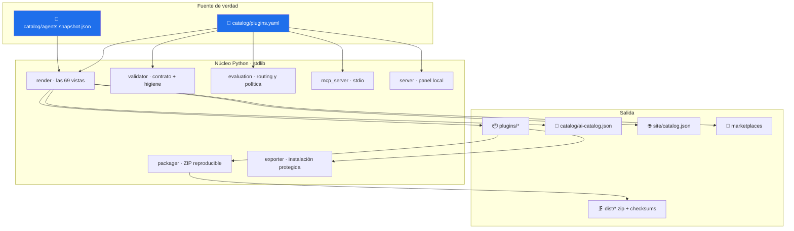
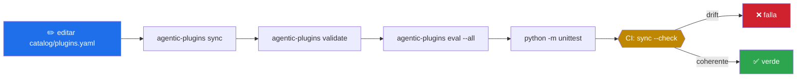

# 🏛 Arquitectura

> Qué componentes existen, dónde está la frontera del sistema y por qué la documentación no puede contradecir al contrato.

[Repositorio](../README.md) · [Documentación](README.md) · [Contrato de plugin](PLUGIN_CONTRACT.md)

---

## Frontera del sistema

Este repositorio **no ejecuta agentes**. No implementa un bucle de LLM, no invoca modelos y no toma decisiones de razonamiento. Lo que hace es:

1. declarar contratos de plugin en un catálogo canónico;
2. generar desde él todo lo que cada plataforma necesita;
3. validar que nada se salga del contrato;
4. evaluar routing y política de forma determinista;
5. empaquetar de forma reproducible y exportar sin pisar lo ajeno.

El razonamiento vive en el host —Claude Code, Codex, Copilot, Gemini o cualquier host MCP— y los agentes vienen de una instantánea versionada de [`operational-ai-agents`](https://github.com/vladimiracunadev-create/operational-ai-agents).



## Los tres niveles de composición

| Nivel | Unidad | Repositorio | Aquí aparece como |
|---|---|---|---|
| Capacidad | skill | `claude-skills-toolkit` | dependencia **opcional** declarada por nombre |
| Trabajador | agente | `operational-ai-agents` | **instantánea versionada** en `catalog/agents.snapshot.json` |
| Paquete | plugin | **este repositorio** | entrada canónica en `catalog/plugins.yaml` |

Un plugin **no** es un agente superior. Es la unidad de instalación y distribución: reúne agentes que ya existen, declara sus límites conjuntos y produce un paquete instalable. Los sistemas multiagente de negocio quedan fuera; esos viven en `langgraph-realworld`.

## Una sola fuente de verdad

`catalog/plugins.yaml` es canónico. De él —más la instantánea de agentes— se generan **69 archivos**:

| Vista generada | Por plugin | Total |
|---|:-:|:-:|
| `plugin.yaml` | 1 | 6 |
| `.codex-plugin/plugin.json` | 1 | 6 |
| `.claude-plugin/plugin.json` | 1 | 6 |
| `.mcp.json` | 1 | 6 |
| `hooks/hooks.json` | 1 | 6 |
| `policies/policy.json` | 1 | 6 |
| `provenance.json` | 1 | 6 |
| `README.md` | 1 | 6 |
| `assets/icon.svg` | 1 | 6 |
| `runtime/mcp_server.py` | 1 | 6 |
| `adapters/` (openai, claude-code, gemini) | 3 | 18 |
| `skills/<id>-workflow/SKILL.md` | 1 | 6 |
| `agents/*.md` + `adapters/github-copilot/*.agent.md` | 2 × agentes | 20 |
| `catalog/ai-catalog.json`, `site/catalog.json`, dos marketplaces | — | 4 |

El único archivo escrito a mano dentro de un paquete es `evals/cases.jsonl`. El validador declara esa excepción en una constante y rechaza cualquier otro archivo, de modo que añadir uno nuevo a mano es imposible sin que la build lo diga.

### Por qué esto no es burocracia

La versión 0.1.0 mantenía a mano seis archivos por plugin. Los seis habían derivado, y uno de ellos —`runtime/mcp_server.py`— **reimplementaba la comparación de políticas**:

```python
# lo que hacía el archivo distribuido
approval = next((x for x in PLUGIN["policy"]["approval_required"] if x in action.lower()), None)
```

```python
# lo que hace la CLI
def _matches(text: str, item: str) -> bool:
    normalized_text = text.casefold().replace("_", "-")
    variants = {item.casefold(), item.casefold().replace("-", " ")}
    return any(variant in normalized_text for variant in variants)
```

Para la acción `BYPASS_APPROVAL` la CLI respondía `denied` y el servidor distribuido respondía `allowed`, porque `"bypass-approval" not in "bypass_approval"`. La divergencia estaba en el archivo que efectivamente viaja dentro del paquete y llega al host.

Hoy `render.py` **copia el código fuente literal** de `policy._matches` y `policy.classify_action` al generar cada servidor, y `test_distributed_server_agrees_with_the_cli` levanta los servidores como subproceso y compara sus respuestas con las de la CLI acción por acción. La coherencia dejó de ser una intención y pasó a ser un mecanismo.

## Componentes del núcleo

| Módulo | Responsabilidad |
|---|---|
| `catalog.py` | descubre la raíz y carga catálogo e instantánea, con errores explícitos |
| `render.py` | define el contenido exacto de las 69 vistas |
| `syncer.py` | escribe las vistas o reporta el drift |
| `validator.py` | contrato, higiene y ausencia de duplicación no gobernada |
| `policy.py` | **única** implementación de la semántica de política y routing |
| `evaluation.py` | ejecuta los `cases.jsonl` contra el router |
| `packager.py` | ZIP deterministas y `checksums.json` |
| `exporter.py` | instalación y desinstalación que respetan lo ajeno |
| `mcp_server.py` | servidor MCP de la CLI |
| `hooks.py` | el ejecutable del hook `SessionStart` |
| `server.py` | panel local con guardia de loopback |
| `cli.py` | los doce comandos y los códigos de retorno |

## Flujo de un cambio



## Decisiones deliberadas

| Decisión | Razón | Costo aceptado |
|---|---|---|
| Cero dependencias de runtime | el paquete se instala en cualquier entorno sin arrastrar árbol | escribir a mano lo que una librería haría |
| `.yaml` con contenido JSON | nombre estándar del ecosistema sin necesitar `pyyaml` | solo se acepta el subconjunto JSON, no YAML completo |
| Agentes por instantánea, no por submódulo | el paquete es autocontenido y auditable | actualizar la instantánea es un acto explícito |
| Copiar el código de política en vez de importarlo | el servidor distribuido funciona sin instalar nada | el archivo generado es más largo |
| Manifiestos por plataforma | no existe un formato universal | mantener cinco proyecciones |

---

<div align="center"><sub><a href="../README.md">Repositorio</a> · <a href="PLUGIN_CONTRACT.md">Contrato</a> · <a href="SECURITY_MODEL.md">Modelo de seguridad</a></sub></div>
