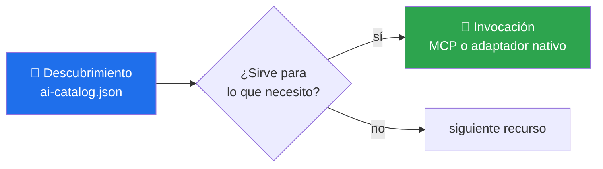

# 🧭 Descubrimiento ARD

> Un catálogo de descubrimiento experimental, y por qué el repositorio se niega a declarar conformidad con una especificación que todavía se mueve.

[Repositorio](../README.md) · [Documentación](README.md) · [Referencias](REFERENCES.md)

---

## Qué publica

[`catalog/ai-catalog.json`](../catalog/ai-catalog.json) es una **vista generada** que expone metadatos de descubrimiento para cada plugin:

```json
{
  "id": "urn:agentic-plugin:repository-engineering:0.2.0",
  "type": "plugin",
  "name": "Repository Engineering",
  "version": "0.2.0",
  "interfaces": [
    {"protocol": "mcp", "transport": "stdio"},
    {"protocol": "plugin-package", "targets": ["openai", "claude-code", "github-copilot", "gemini", "generic-mcp"]}
  ],
  "path": "../plugins/repository-engineering"
}
```

Al ser generado, la versión del URN no puede quedarse atrás de la del catálogo. En la versión anterior este archivo se mantenía a mano y sus URNs seguían apuntando a `0.1.0` después de cada bump.

## La declaración explícita

```json
"status": "ARD_READY_NOT_CONFORMANCE_CLAIM"
```

Significa exactamente lo que dice: el repositorio publica metadatos **compatibles con la idea** de un descubrimiento de recursos agénticos, pero **no afirma conformidad** con [ARD](https://github.com/ards-project/ard-spec), que sigue evolucionando.

`test_ard_is_explicitly_experimental` verifica que ese estado no cambie sin que alguien lo decida a propósito.

## Descubrimiento ≠ invocación

Son dos momentos distintos y conviene no confundirlos:



El catálogo de descubrimiento responde *«¿qué existe y para qué sirve?»*. La ejecución ocurre después, por MCP o por el adaptador nativo de la plataforma, y con los permisos del host. Un metadato de descubrimiento **no** otorga capacidad de ejecución.

## Por qué no se promete más

Declarar conformidad con una especificación en movimiento tiene un costo asimétrico: si la spec cambia, el repositorio queda afirmando algo falso sin que nadie lo note. Publicar metadatos útiles y decir «esto no es una certificación» cuesta una línea de JSON y no envejece mal.

Cuando ARD se estabilice, la promoción será un cambio explícito con changelog, no un silencio que se reinterpreta.

---

<div align="center"><sub><a href="../README.md">Repositorio</a> · <a href="REFERENCES.md">Referencias</a> · <a href="MATURITY_MODEL.md">Madurez</a></sub></div>
